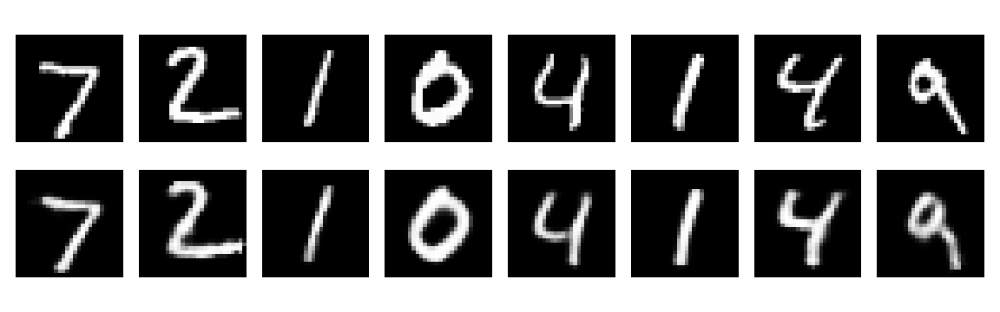
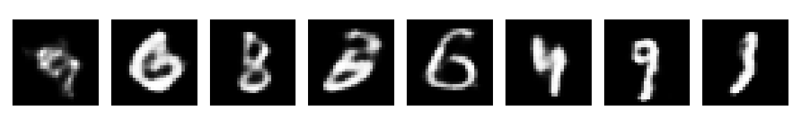

***

```markdown
# Variational Autoencoder (VAE) for MNIST


A clean, from-scratch implementation of a **Variational Autoencoder (VAE)** using PyTorch. This model is trained on the **MNIST** dataset to reconstruct handwritten digits and generate entirely new ones by sampling from the latent space.

## 📌 Features
- **Custom Architecture**: Built from scratch using Multi-Layer Perceptrons (MLPs).
- **Reparameterization Trick**: Implemented to allow backpropagation through the stochastic latent space.
- **β-VAE Loss Function**: Combines Binary Cross-Entropy (Reconstruction Loss) with Kullback-Leibler (KL) Divergence.
- **KL Annealing**: Gradually increases the weight of the KL divergence (`beta`) during training.
- **Checkpointing**: Automatically saves both the best model (`vae_best.pt`) and the latest state (`vae_last.pt`).

---

## 🏗 Algorithm Architecture

The diagram below illustrates the structure of the VAE. It consists of an **Encoder**, a **Gaussian Distribution (Latent Space)**, and a **Decoder**.

```text
       +-------------------+
       |   Input Image     |
       |     (784 Dims)    |
       +---------+---------+
                 |
                 v
       +---------+---------+
       |      ENCODER      |
       |  Linear(784, 400) |
       |       Tanh        |
       +----+---------+----+
            |         |
            v         v
       +----+----+ +--+------+
       |   μ     | | log(σ²) |
       | (Mean)  | | (LogVar)|
       | 20 Dims | | 20 Dims |
       +----+----+ +--+------+
            |         |
            +----+----+
                 |
                 v
          +------+------+
         /               \
        |  LATENT SPACE   |
        |      (z)        |
        | Gaussian N(0,I) |
        |    20 Dims      |
         \               /
          +------+------+
                 |
                 v
       +---------+---------+
       |      DECODER      |
       |  Linear(20, 400)  |
       |       Tanh        |
       |  Linear(400, 784) |
       |      Sigmoid      |
       +---------+---------+
                 |
                 v
       +---------+---------+
       |  Output Image     |
       |     (784 Dims)    |
       +-------------------+
```

### Loss Function
The model optimizes the Evidence Lower Bound (ELBO). The loss is defined as:

\[
 \mathcal{L} = - \sum_{i=1}^{N} \left[ x_i \log(y_i) + (1 - x_i) \log(1 - y_i) \right] + \beta \cdot D_{KL}(q(z|x) || p(z)) 
\]

- **Reconstruction Loss**: Binary Cross-Entropy (BCE) between input (\(x\)) and output (\(y\)).
- **KL Divergence**: Regularizes the latent space to follow \(\mathcal{N}(0, I)\).
- **Beta (β)**: Scales the KL term (KL Annealing).

---

## 🚀 Installation

Clone the repository and install the required dependencies:

```bash
git clone https://github.com/your-username/your-repo-name.git
cd your-repo-name
pip install torch torchvision matplotlib pillow numpy
```

---

## 💻 Usage

### 1. Training
To train the model from scratch, run:
```bash
python Vae_Train.py
```
*Note: The script saves checkpoints to `SAVE_DIR`. You can modify this path in `Vae_Train.py`.*

### 2. Inference & Generation
To evaluate the model, reconstruct digits, and generate new samples, run:
```bash
python Vae_Inference.py
```
This script performs three tasks:
1. **Reconstruction (`reconstruct_from_testset`)**: Compares original images with reconstructed ones.
2. **Sampling (`sample_from_prior`)**: Generates new digits by sampling random vectors.
3. **Custom Image Testing (`reconstruct_from_path`)**: Preprocesses and reconstructs an external image file.

---

## 📊 Results

### Reconstruction
The model successfully compresses the images into a 20-dimensional latent space and reconstructs them with high fidelity. 

*(Original images on top, Reconstructed images on the bottom)*


### Generation (Sampling from Prior)
By sampling random points from the Gaussian distribution and passing them to the decoder, the model generates novel handwritten digits.



---

## 📂 Dataset
The project uses the standard **MNIST** dataset (60,000 training images, 10,000 testing images). The `torchvision` library automatically handles the download and preprocessing of the dataset.

```python
train_ds = datasets.MNIST(root="./data", train=True, download=True, transform=transforms.ToTensor())
```

## 🤝 Contributing
Contributions, issues, and feature requests are welcome! 
```

***

